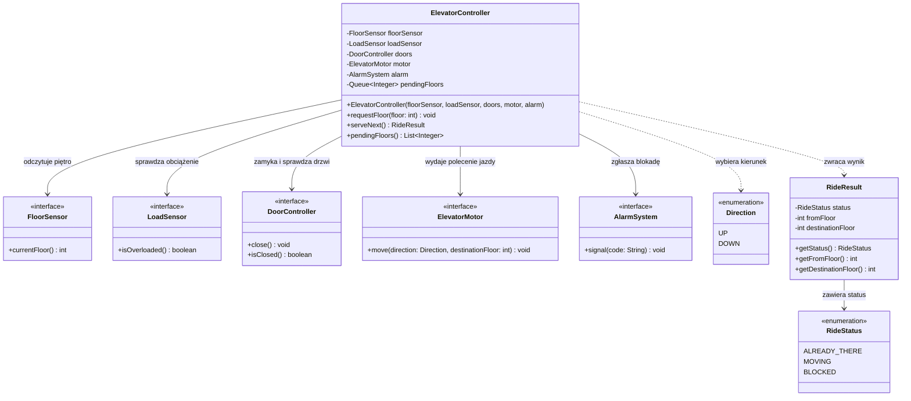

# Winda — ćwiczenie TDD

Projekt jest szkieletem ćwiczenia z programowania sterowanego testami (TDD). Celem jest stopniowe zaimplementowanie sterownika windy w Javie, zaczynając od najmniejszego przypadku i rozwijając rozwiązanie na podstawie testów.

## Diagram klas



Diagram przedstawia docelową współpracę klas w ćwiczeniu. Sterownik korzysta z interfejsów urządzeń, dzięki czemu w testach można zastąpić je mockami.

## Oczekiwane działanie po implementacji

- `requestFloor(floor)` dodaje zgłoszenie do kolejki obsługiwanej w kolejności FIFO.
- `serveNext()` pobiera bieżące piętro i obsługuje następne zgłoszenie:
  - gdy winda jest już na żądanym piętrze, zwraca `ALREADY_THERE` bez uruchamiania drzwi, silnika ani alarmu;
  - przed rozpoczęciem jazdy sprawdza przeciążenie. Przy przeciążeniu zwraca `BLOCKED`, sygnalizuje alarm `OVERLOAD`, nie zamyka drzwi ani nie uruchamia silnika, a zgłoszenie pozostaje w kolejce;
  - jeśli nie ma przeciążenia, zamyka drzwi i sprawdza ich stan. Jeśli nadal są otwarte, zwraca `BLOCKED`, sygnalizuje `DOOR_OPEN`, nie uruchamia silnika i zachowuje zgłoszenie do ponowienia;
  - jeśli warunki bezpieczeństwa są spełnione, uruchamia silnik w kierunku `UP` lub `DOWN`, zwraca `MOVING` i usuwa obsłużone zgłoszenie z kolejki.
- Każdy `RideResult` zawiera status, piętro początkowe i piętro docelowe.
- `pendingFloors()` udostępnia niemodyfikowalny widok/kopię oczekujących zgłoszeń, a nie wewnętrzną kolejkę.

Ćwiczenie nie definiuje dodatkowych reguł, takich jak walidacja numeru piętra ani zachowanie `serveNext()` przy pustej kolejce.

## Praca według TDD

Testy w `src/test/java/pl/edu/pjatk/mpr/elevator/ElevatorControllerTest.java` opisują kolejne iteracje. Są początkowo oznaczone `@Disabled`, aby umożliwić pracę etapami. Na danym etapie usuń `@Disabled` tylko z aktualnego testu:

1. Włącz test `floorAlreadyReached_doesNotStartAnyDevice`. Uruchom go i sprawdź, że kończy się niepowodzeniem (**RED**). Zaimplementuj tylko najprostsze rozwiązanie, które go przechodzi (**GREEN**), a następnie uporządkuj kod bez zmiany zachowania (**REFACTOR**).
2. Powtórz cykl dla `floorAbove_closesDoorsBeforeMovingUp`, zachowując wymaganą kolejność: zamknięcie drzwi, kontrola ich stanu, polecenie dla silnika.
3. Włącz `floorBelow_movesDown` i dodaj obsługę jazdy w dół.
4. Włącz `doorsStayOpen_blocksRideAndRaisesAlarm`; dodaj blokadę jazdy i zachowanie zgłoszenia do ponowienia.
5. Włącz `overloadedElevator_doesNotCloseDoorsOrMove`; sprawdzaj przeciążenie przed obsługą drzwi.
6. Na końcu włącz `multipleRequests_areServedInFifoOrder` i dodaj kolejkę FIFO oraz bezpieczne udostępnianie oczekujących pięter.

Po każdej iteracji uruchom testy i utrzymuj wszystkie dotychczasowe przypadki w stanie zielonym. Nie implementuj z wyprzedzeniem zachowań, których nie wymaga aktualny test.

## Uruchamianie

Wymagane: JDK 11 lub nowszy oraz Maven.

```bash
mvn test
```

Na początku ćwiczenia testy są wyłączone, a implementacja zawiera celowe atrapy. Włączaj je kolejno zgodnie z powyższymi krokami; pełne `mvn test` będzie weryfikować wszystkie zaimplementowane zachowania.
