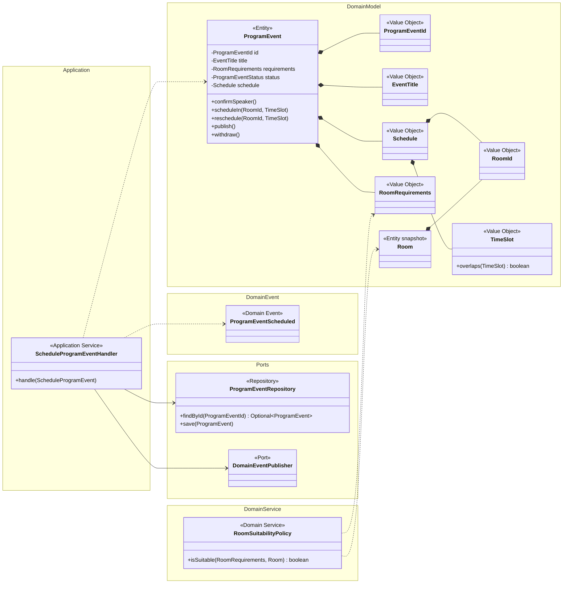

# Diagram klas

Handler aplikacyjny zależy od portów, a decyzje pozostają w modelu. `RoomSuitabilityPolicy` jest usługą domenową, ponieważ decyzja o dopasowaniu nie należy naturalnie wyłącznie do punktu programu ani wyłącznie do sali.
